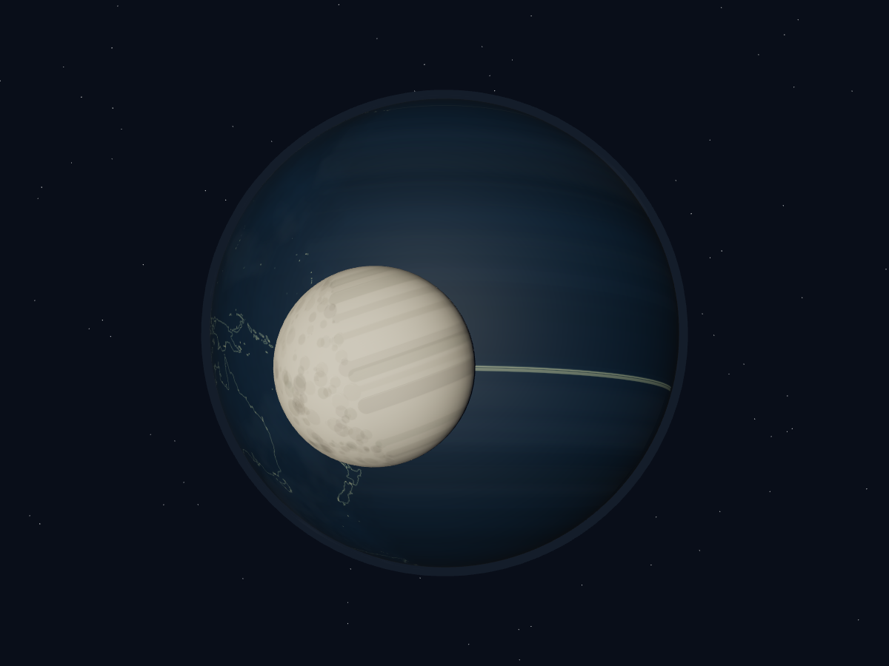
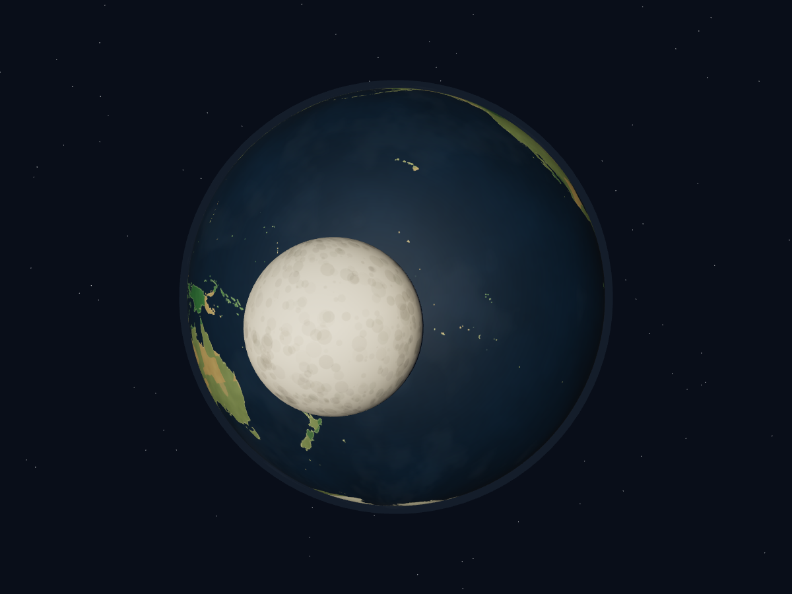

# 地球、月球横带：修复前后对比

以下是 Chromium 实际 WebGL 截图，模拟时间均为 `2026-10-10T23:00:00Z`，镜头面向地球南纬 10°、西经 160°，距离地心 23 个场景单位。隐藏界面文字以便看清纹理；两张图使用相同镜头、灯光和天体位置。

## 修复前

基线提交 `73f6985` 已移除轨道辅助线，横带仍然存在：太平洋海岸线被拉长，月球月坑被拉成条纹。

## 修复后

## 已确认的原因

- 地球、云层及两个页面的月球贴图都使用了 `offset.x = 0.25`，但横向保持默认的 `ClampToEdgeWrapping`。例如原始 U 坐标 `0.95` 偏移后为 `1.20`，被钳制成 `1.00`，使整片球面重复取图像最右边的一列像素。改为 `RepeatWrapping` 后，正确采样位置为 `0.20`。纬度方向仍然钳制在两极。
- 地球陆地遮罩使用了绑定到主画布的 `geoPath`，实际遮罩画布为空，所有区域都被当作海洋填色。现在路径直接画入遮罩画布。
- 月球贴图统一生成；左右边缘使用相同的底色，跨边缘的月坑在另一端补绘，避免环绕后出现接缝。

## 验证

- `npm test`：8 项通过，包括横向越界采样与极点采样回归测试。
- `npm run build`：通过，保留既有的大文件体积提示。
- Chromium：同角度检查太平洋及月球近景；两个页面无 JavaScript 页面错误。天空页的时间播放、拖动朝向正常。
- 地图海岸线来自 Natural Earth；海陆颜色、云层及月坑仍为教学用程序化示意纹理。
